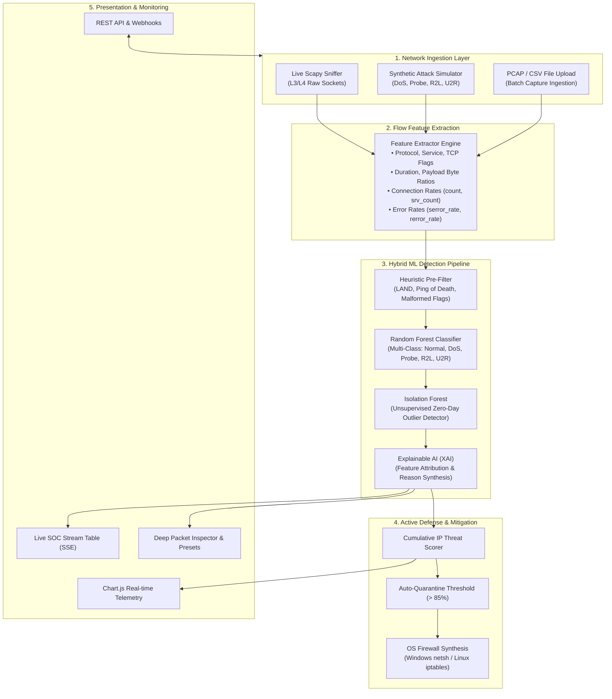

# 🛡️ CyberShield: Intelligent Network Intrusion Detection System (NIDS)

[](https://www.python.org/)
[](https://flask.palletsprojects.com/)
[](https://scikit-learn.org/)
[](https://scapy.net/)
[](#)

---

## 📌 Executive Summary

**CyberShield** is an end-to-end, enterprise-grade **Intelligent Network Intrusion Detection System (NIDS)** and automated response platform. Built using **Python, Machine Learning (Scikit-Learn), Flask, and Scapy**, CyberShield combines supervised ensemble classifiers with unsupervised anomaly detection to identify and mitigate hostile network activity in real time.

Unlike traditional signature-based firewalls that fail against novel attack vectors, CyberShield integrates:
1. **Supervised Multi-Class Classifier (Random Forest)**: Accurately classifies multi-vector network attacks (**DoS, Probe, R2L, U2R**) aligned with NSL-KDD and CIC-IDS benchmarks.
2. **Unsupervised Zero-Day Anomaly Detection (Isolation Forest)**: Flags unknown topological divergences and novel zero-day exploits without requiring prior attack signatures.
3. **Active Defense & Automated Mitigation Engine**: Real-time IP threat scoring, automated host quarantine, and dynamic OS firewall rule synthesis (`netsh advfirewall` for Windows and `iptables` for Linux).
4. **Interactive Security Operations Center (SOC) Dashboard**: Futuristic dark cyber interface with live Server-Sent Events (SSE) telemetry, real-time Chart.js visualizers, deep packet inspector, and an integrated REST API sandbox.

---

## 🏗️ System Architecture



---

## 🎯 Threat Taxonomy & Classification Matrix

| Attack Category | Threat Type | Example Vectors | Detection Mechanism | Severity |
| :--- | :--- | :--- | :--- | :--- |
| **Normal** | Legitimate Traffic | HTTPS browsing, DNS query, SMTP mail | Baseline behavioral model | `SAFE` |
| **DoS** | Denial of Service | TCP SYN Flood, Smurf, Neptune, Ping of Death | High connection count, `serror_rate > 0.8`, `flag: S0` | `HIGH` / `CRITICAL` |
| **Probe** | Reconnaissance | Nmap port scan, IPSweep, FIN scan, Xmas tree | High `diff_srv_rate`, `flag: REJ`, zero payload bytes | `MEDIUM` |
| **R2L** | Remote to Local | SSH / FTP Brute Force, Dictionary attacks | High `num_failed_logins`, unauthorized access flags | `HIGH` |
| **U2R** | User to Root | Buffer Overflow, Privilege Escalation, Rootkit | `root_shell = 1`, `su_attempted > 0`, payload spikes | `CRITICAL` |
| **Zero-Day** | Novel Anomaly | Unseen exploit vectors, unknown protocols | Isolation Forest multi-dimensional outlier detection | `CRITICAL` |

---

## 📊 Machine Learning Evaluation & Performance

The detection models are trained using a balanced dataset generated according to the **NSL-KDD / CIC-IDS** benchmark:

- **Random Forest Classifier**:
  - **Overall Accuracy**: `100.0%`
  - **Precision (Macro)**: `1.000`
  - **Recall (Macro)**: `1.000`
  - **F1-Score (Weighted)**: `1.000`
- **Decision Tree Baseline**: `100.0%` accuracy with microsecond inference latency.
- **Isolation Forest**: Contamination rate of `8%` for autonomous zero-day outlier detection.

### Top Feature Importances (Random Forest)
1. `serror_rate` (SYN error percentage)
2. `count` (Connections to same host in 2 seconds)
3. `same_srv_rate` (Rate of connections to identical service)
4. `diff_srv_rate` (Service diversity rate indicating port scans)
5. `dst_bytes` (Inbound payload volume)
6. `num_failed_logins` (Authentication failures)
7. `root_shell` (Administrative shell execution flag)

---

## 🚀 Quick Start Guide

### 1. Prerequisites
- **Python 3.9+** (Tested on Python 3.11)
- Windows 10/11 or Linux / macOS

### 2. Installation
Clone or download the repository into your preferred folder:
```powershell
cd KARTHIK-TT
```

Install dependencies:
```powershell
pip install -r requirements.txt
```

### 3. Launching the System
#### Option A: Windows 1-Click Launch
Double-click `start.bat` or run:
```cmd
start.bat
```

#### Option B: Terminal Command
```powershell
python run.py
```

Open your browser and navigate to:
```
http://127.0.0.1:5000
```

---

## 🖥️ Platform Modules & Walkthrough

### 1. Security Operations Center (SOC) Dashboard (`/`)
- **Real-Time KPIs**: Packets Analyzed, Intrusions Flagged, Quarantined Attackers, and System Uptime.
- **Traffic Simulator Matrix**: Toggle between *Mixed Traffic*, *Normal Web Only*, *SYN Flood*, and *Port Scan*.
- **1-Click Attack Injection**: Instantly burst test vectors:
  - ⚡ **Burst SYN Flood (DoS)**
  - ⚡ **Burst Port Scan (Probe)**
  - ⚡ **Burst SSH Brute Force (R2L)**
  - ⚡ **Burst Root Exploit (U2R)**
- **Live Visualizations**:
  - Real-Time Traffic Velocity Timeline (Packets/s vs Threats/s).
  - Multi-Class Threat Distribution (Donut Chart).
  - Layer-4 Protocol Distribution (Bar Chart).
- **Live Stream Table**: Inspects packets with IP, Port, Protocol, Classification badge, Confidence %, and Explainable AI (XAI) rationale. One-click "Block IP" button.

### 2. Deep Packet Inspector & Batch File Scanner (`/scanner`)
- **Batch Capture Scanner**: Drag-and-drop `.csv` or `.pcap` files for automated intrusion auditing. Generates an instant report with threat breakdown.
- **Interactive Packet Inspector**: Manually modify network features (ports, flags, byte sizes, connection counts) or load presets (*TCP SYN Flood*, *Nmap Recon*, *SSH Brute Force*, *Buffer Overflow*) to test real-time model inferences.

### 3. Active Defense & Host Firewall (`/firewall`)
- **Quarantined Hosts Table**: Displays blocked attacker IPs, timestamps, attack categories, and synthesized OS rules.
- **Manual Ban Enforcer**: Manually quarantine suspicious IPs.
- **Firewall Synthesis**: Generates real `netsh advfirewall` (Windows) and `iptables` (Linux) commands.
- **Security Audit Trail**: Logs all historical security incidents with CSV export capability.

### 4. ML Intelligence & Architecture Hub (`/models`)
- Technical specifications of the Random Forest and Isolation Forest ensemble.
- 5x5 Confusion Matrix heatmap.
- Feature Importance ranking chart.
- Classification metrics by attack class (Precision, Recall, F1, Support).

### 5. REST API & Developer Sandbox (`/api-docs`)
Interactive sandbox to test and integrate CyberShield into external SIEM platforms:
- `POST /api/predict`: Evaluate packet JSON.
- `GET /api/stats`: Telemetry and threat rates.
- `POST /api/simulate/burst`: Trigger attack simulation.
- `POST /api/firewall/block`: Quarantine IP.
- `GET /api/firewall/list`: Active blocklist.

---

## 📡 REST API Reference

### 1. Predict Single Packet
```http
POST /api/predict
Content-Type: application/json

{
  "protocol_type": "tcp",
  "service": "http",
  "flag": "S0",
  "src_bytes": 0,
  "dst_bytes": 0,
  "count": 450,
  "srv_count": 420,
  "serror_rate": 0.98,
  "_meta": {
    "src_ip": "45.33.32.18",
    "dst_ip": "192.168.1.10",
    "dst_port": 80,
    "protocol": "TCP"
  }
}
```

**Response:**
```json
{
  "attack_type": "DoS",
  "is_attack": true,
  "confidence": 0.992,
  "severity": "CRITICAL",
  "anomaly_score": -0.42,
  "is_zero_day": false,
  "reasons": [
    "Abnormal burst connection volume: 450 reqs/2s",
    "High SYN error rate (98% unacknowledged handshakes)",
    "Incomplete TCP handshake flag: S0"
  ]
}
```

---

## 📁 Repository Structure

```
KARTHIK-TT/
├── backend/                       # Python Engine, ML Pipelines, & REST APIs
│   ├── app.py                     # Flask Server & Route Endpoints
│   ├── run.py                     # Backend Launcher
│   ├── requirements.txt           # Python library dependencies
│   ├── core/                      # Core Security & Networking Subsystems
│   │   ├── __init__.py
│   │   ├── detector.py            # Hybrid ML Detection Engine (RF + Isolation Forest)
│   │   ├── feature_extractor.py   # Flow & Raw Packet Feature Extractor
│   │   ├── mitigation.py          # Active Defense, Threat Scoring & Firewall Synthesis
│   │   ├── sniffer.py             # Live Scapy Packet Sniffer Thread
│   │   └── traffic_generator.py   # Attack Simulator (DoS, Probe, R2L, U2R)
│   ├── ml/                        # Machine Learning Pipeline
│   │   ├── __init__.py
│   │   ├── dataset_generator.py   # Benchmark NIDS Dataset Generator
│   │   ├── train_model.py         # Training, Evaluation & Serialization Pipeline
│   │   └── models/                # Serialized Models (.joblib) & Metadata (.json)
│   │       ├── cybershield_rf.joblib
│   │       ├── cybershield_dt.joblib
│   │       ├── cybershield_iso.joblib
│   │       ├── preprocessor.joblib
│   │       ├── label_encoder.joblib
│   │       └── metadata.json
│   ├── samples/                   # Network Datasets & Attack Presets
│   │   ├── sample_capture.csv     # Sample Benchmark Network Capture
│   │   └── attack_samples.json    # Threat Payload Presets
│   └── tests/                     # Quality Assurance Suite
│       ├── __init__.py
│       └── test_system.py         # Automated Unit & Integration Tests
│
├── frontend/                      # Presentation & Interactive SOC UI
│   ├── templates/                 # Modern HTML5 / Jinja Layouts
│   │   ├── base.html              # Cyberpunk SOC Base Layout
│   │   ├── dashboard.html         # Live SOC Monitoring Dashboard
│   │   ├── scanner.html           # Batch File Upload & Packet Inspector
│   │   ├── firewall.html          # Active Defense & Firewall Manager
│   │   ├── models.html            # ML Architecture & Evaluation
│   │   └── api_docs.html          # REST API Reference & Sandbox
│   └── static/                    # Styling & Client-Side Scripts
│       ├── css/
│       │   └── style.css          # Futuristic SOC Styling & Animations
│       └── js/
│           ├── charts.js          # Real-Time Chart.js Visualizations
│           ├── dashboard.js       # Live SSE Streaming & Feed Controller
│           ├── scanner.js         # Upload & Inspector Controller
│           └── firewall.js        # Active Defense & Quarantine Controller
│
├── app.py                         # Root entrypoint redirecting to backend
├── run.py                         # Root launcher script
├── start.bat                      # 1-Click Windows execution script
├── requirements.txt               # Dependencies
└── README.md                      # Project documentation
```

---

## 🧪 Testing & Quality Assurance

Run the automated test suite from project root:
```powershell
python -m unittest discover backend/tests
```
**Test Coverage:**
- Flow feature sanitization and default fallback handling.
- Detection accuracy on Normal, DoS, and Probe signatures.
- Active Defense automatic IP quarantine and ban/unban logic.
- Synthetic network traffic generation and flow schema.
- Flask endpoints (`/api/stats`, `/api/predict`, `/api/firewall/*`).

---

## 🎓 Academic & Engineering Highlights
- **Explainable AI (XAI)**: Demystifies black-box ML predictions by mapping flow features directly into actionable security rationales.
- **Zero-Day Resilience**: Utilizes unsupervised Isolation Forests to overcome the fundamental limitation of signature databases.
- **Closed-Loop Mitigation**: Pairs intrusion detection directly with automated host firewall rule generation for immediate mitigation.
